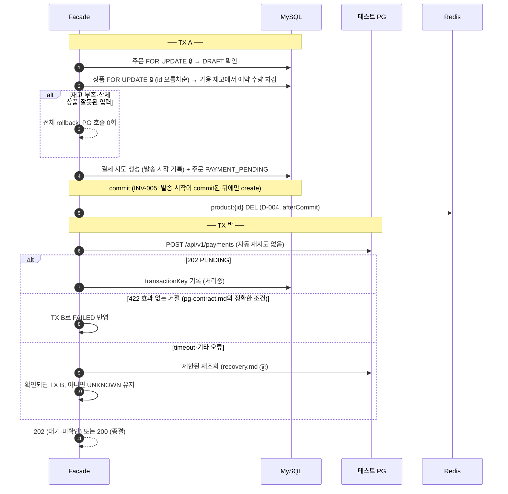
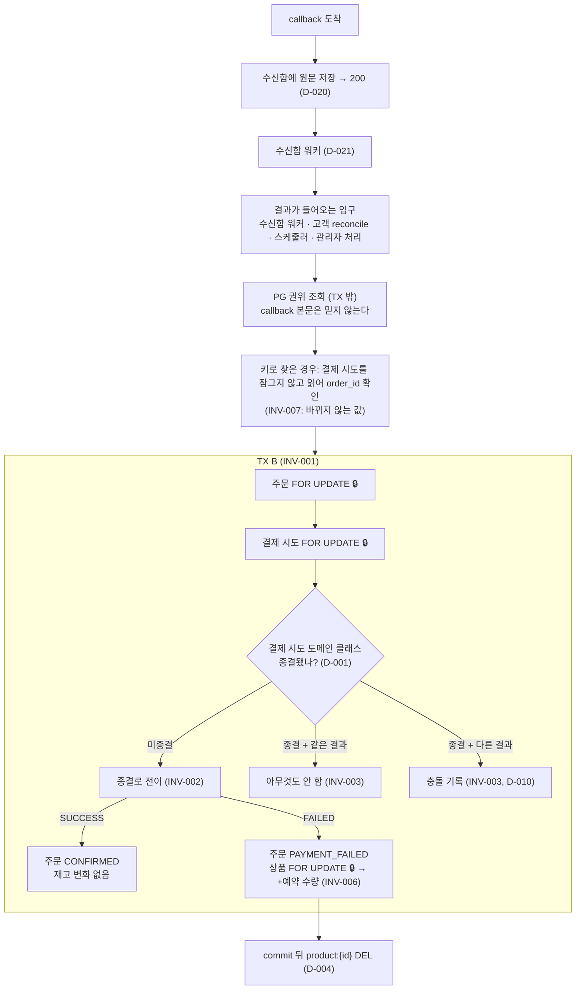

# 5주차 설계 문서 — 응답을 잃은 결제는 실패가 아니다

4주차까지의 설계(`docs/week2~4/design.md`)를 이어받는다. 이 문서는 이번 주에 **바뀌거나 새로 정한 것**만 적는다.

5주차 문서는 세 파일로 나눈다. **불변식(INV)과 결정(D)은 이 파일에만 적는다.** 다른 파일은 번호로만 가리키고 내용을 다시 쓰지 않는다. 같은 사실이 두 곳에 적히면 언젠가 어긋나기 때문이다.

| 파일 | 내용 |
|---|---|
| `design.md` (이 파일) | 범위, 상태 모델, 트랜잭션 경계, 불변식, 결정, 보류, 미정 |
| `pg-contract.md` | 외부가 정한 사실: 테스트 PG API, 응답별 매핑, 식별자, callback, commerce API |
| `recovery.md` | 회복 전략과 측정 전 수치: 재조회, circuit breaker, 스케줄러, 관리자 확인 |

## 1. 이번 주 범위 — 사실과 결정

| 구분 | 내용 |
|---|---|
| 과제가 명시한 사실 | 미확정(DRAFT) 주문의 결제를 포인트에서 **로컬 테스트 PG**로 바꾼다. 포인트 차감은 0회다. 이전 POINT 결제 주문은 사실 그대로 조회한다. |
| 과제가 명시한 사실 | 확정은 **TX A(재고 확보·시도 기록) → TX 밖 PG 호출 → TX B(결과 반영)**로 나눈다. PG 호출 동안 DB 트랜잭션과 재고 잠금을 쥐지 않는다. |
| 과제가 명시한 사실 | timeout은 실패가 아니다. create는 자동 재시도하지 않는다. PG 장애 때 포인트로 대신 결제하지 않는다. 카드 번호는 DB·로그에 남기지 않는다. |
| 과제가 명시한 사실 | 주문당 결제 시도는 하나다. 실패 후 새 결제 시도, 환불, 정산, 사용자 취소는 구현하지 않는다. |
| 과제가 명시한 사실 | circuit breaker는 PG **조회** 한 경로에만 적용한다. 수동 reconcile이 기본 회복 경로이고 스케줄러는 선택이다. |
| 이번 주에 정할 결정 | 아래 각 섹션. |

## 2. 상태 모델 — 주문 축과 결제 축

주문과 결제 시도는 서로 다른 질문에 답한다.

| 축 | 답하는 질문 | 값 |
|---|---|---|
| 주문 | 고객·업무에게 이 주문은 어디까지 왔나 | DRAFT, PAYMENT_PENDING, CONFIRMED, PAYMENT_FAILED (+ 기존 POINT 확정 주문) |
| 결제 시도 | 외부 사실에 대해 **우리가 지금 무엇을 아는가**, 그래서 PG에 어떻게 물어야 하나 | 요청됨(발송 중, 키 모름 → 목록 조회), 처리중(`transactionKey` 앎 → 단건 조회), UNKNOWN(응답 잃음, 키 모름 → `providerOrderId` 목록 조회), SUCCESS, FAILED (D-017) |

UNKNOWN은 실패가 아니다. 외부 거래는 결국 종결되지만, **우리의 앎**은 계속 모를 수 있다.

| PG 관찰 | 결제 시도 | 주문 | 재고 예약 |
|---|---|---|---|
| 생성 수락 PENDING | 처리중 | PAYMENT_PENDING | 유지 |
| timeout·응답 유실·조회 불가 | UNKNOWN | PAYMENT_PENDING | 유지 |
| 조회로 확인한 SUCCESS | SUCCESS | CONFIRMED | 소비 (추가 차감 없음) |
| 조회로 확인한 FAILED, 효과 0건 확정 거절 | FAILED | PAYMENT_FAILED | 한 번 반환 |
| 0건·2건 이상·주문/금액 불일치 | 그대로 (충돌 기록) | 그대로 | 그대로, 재발송 없음 |

```
          TX A
           │
       요청됨 ──202 PENDING──▶ 처리중 ──┐
           │                            ├──조회로 확인──▶ SUCCESS / FAILED
           ├──timeout·오류──▶ UNKNOWN ──┘
           │
           └──422 효과 없는 거절──▶ FAILED
```

용어: **미종결** = 요청됨·처리중·UNKNOWN, **종결** = SUCCESS·FAILED. **기록된 결제 상태** = 우리 DB의 결제 시도 상태, **PG 관찰 결과** = PG 조회로 확인한 거래의 키·상태·금액. 충돌은 이 둘이 어긋난 상황이다.

TX A는 결제 시도를 **요청됨**으로 만든다(D-017). 살아 있는 서버에서는 timeout 안에 처리중이나 UNKNOWN으로 넘어가므로, timeout보다 오래 요청됨에 남은 시도는 PG 호출 도중 서버가 죽었다는 흔적이다.

## 3. 트랜잭션 경계

### 확정 요청 (`POST /api/v1/orders/{orderId}/confirm`)



### 결과 반영 (TX B) — callback, reconcile, 스케줄러, 관리자 처리가 모두 지나는 경계



락 순서는 주문 → 결제 시도 → 상품(id 오름차순)이다(D-002). 기존 규칙(주문 → 상품 → 사용자)과 같은 방향이다.

## 4. 불변식과 반례

### INV-001 · 결과 반영은 하나의 트랜잭션
- **규칙:** 결제 시도, 주문, 재고 예약은 결과 반영 트랜잭션(TX B) 하나에서 함께 바뀐다.
- **출처:** 실습 조건 ("성공·반환 상태와 재고 변경을 같은 TX에서 보호")
- **반례:** 결제를 SUCCESS로 commit한 직후, 주문을 바꾸기 전에 서버가 죽는다. 결제는 SUCCESS인데 주문은 PAYMENT_PENDING에 남는다.
- **기대 결과:** 셋 중 하나라도 실패하면 모두 롤백된다. 같은 외부 결과를 다시 조회해 적용할 수 있다.
- **책임:** TX B 경계(application)

### INV-002 · 전이는 한 번, 효과는 전이에서만
- **규칙:** 결제 시도는 미종결에서 종결로 한 번만 전이한다. 재고 반환과 예약 소비는 그 전이에서만 일어난다.
- **출처:** 실습 조건 + 설계 대화
- **반례 1:** 같은 FAILED가 두 번 들어와 매번 +2를 하면 가용 재고가 5가 아니라 7이 된다.
- **반례 2:** callback과 reconcile의 TX B가 겹쳐서 둘 다 "미종결"로 읽으면 +2가 두 번 일어난다. 같은 밀리초에 올 필요는 없다. 앞의 TX B가 commit하기 전에 뒤의 TX B가 상태를 읽기만 하면 된다. TX B 앞에 수백 ms의 PG 조회가 있어 겹치기 쉽다.
- **기대 결과:** 몇 번, 어떤 순서로, 동시에 들어와도 재고 변화는 한 번이다.
- **책임:** 결제 시도 도메인 클래스가 종결 여부를 검사하고(D-001), 행 락으로 동시 진입을 직렬화한다(D-002).

### INV-003 · 종결 뒤에 들어온 결과
- **규칙:** 종결된 시도에 같은 결과가 다시 들어오면 아무것도 바꾸지 않는다. 다른 결과가 들어오면 결제, 주문, 재고는 바꾸지 않고 충돌로 기록한다.
- **출처:** 실습 조건 ("종결 뒤 상충하는 응답은 덮어쓰지 않는다") + 설계 대화
- **반례 1:** callback으로 CONFIRMED가 된 뒤 처음 create의 timeout 처리가 늦게 실행되어 UNKNOWN으로 되돌린다.
- **반례 2:** 관리자가 FAILED로 처리한 뒤 PG에서 SUCCESS가 확인됐는데 그냥 무시한다. 고객 돈은 나갔는데 아무 기록도 남지 않는다.
- **기대 결과:** 종결 상태는 유지되고, 충돌은 관리자 확인 목록에 오른다.
- **책임:** 결제 시도 도메인 클래스

### INV-004 · 미확인은 실패가 아니다
- **규칙:** timeout, 조회 0건, 조회 실패, circuit breaker OPEN은 FAILED의 근거가 아니다. FAILED는 PG 조회로 확인된 FAILED, 효과 0건 확정 거절(`pg-contract.md`의 422 조건), 관리자가 PG 쪽에 거래가 없음을 직접 확인한 경우(D-009)에만 정한다.
- **출처:** 실습 조건 + 설계 대화
- **반례:** OPEN을 FAILED로 처리하면 오탐 한 번에 멀쩡한 결제가 실패가 되고 재고가 풀린다. 나중에 SUCCESS가 확인되면 초과 판매가 된다.
- **기대 결과:** 확인하지 못한 동안 결제 시도와 예약은 그대로 유지되고, 응답은 "현재 상태 + 확인 불가"다.
- **책임:** 결제 시도 도메인 클래스 (상태 전이 메서드가 허용하는 근거를 제한)

### INV-005 · 재발송 금지
- **규칙:** create는 발송 시작이 DB에 commit된 뒤에만 보낸다. 발송을 시작한 시도에는 어떤 이유로도 create를 다시 보내지 않는다.
- **출처:** 실습 조건
- **반례:** PG 호출 뒤에 기록하면, 호출 직후 서버가 죽었을 때 재시작한 서버가 "보낸 적 없음"으로 판단하고 다시 보낸다. 거래가 2건이 되고 돈이 두 번 나간다.
- **기대 결과:** 실제 create 호출은 시도당 최대 1회다. 기록만 하고 실제로 못 보낸 시도는 UNKNOWN으로 남고 관리자 확인으로 간다. 두 실수 중 되돌릴 수 있는 쪽(결제 미완료)을 고른 것이다.
- **책임:** TX A(application), HTTP client·회복 라이브러리의 숨은 재시도 끄기(infrastructure)

### INV-006 · 가용 재고와 반환
- **규칙:** `stock_remaining`은 가용 재고다. TX A에서 예약 수량만큼 빼고, FAILED 전이에서 예약 수량만큼 **더한다.** SUCCESS 전이는 바꾸지 않는다. 단, FAILED 전이 시점에 이미 삭제된 상품은 더하지 않는다(D-019).
- **출처:** 실습 조건(5 → 3 → 성공 3 / 실패 5) + 설계 대화
- **반례:** 가용 3(2개 예약 중)일 때 관리자가 2로 바꾼 뒤 FAILED가 오면, "예약 전 값 5로 되돌리기"는 관리자 변경을 지운다. 맞는 값은 4다.
- **기대 결과:** 반환은 상대값 더하기이고, INV-002에 따라 한 번만 일어난다.
- **책임:** `Stock` 값 객체 (기존 `decrease`와 같은 상대 연산)

### INV-007 · 결제 시도의 주문 참조는 바뀌지 않는다
- **규칙:** 결제 시도의 `order_id`는 생성할 때 정해지고 바뀌지 않는다.
- **출처:** 설계 대화
- **반례:** `order_id`를 바꿀 수 있으면, callback이 잠그지 않고 읽은 주문 번호와 실제로 잠근 주문이 달라져 다른 주문에 결과를 반영할 수 있다.
- **기대 결과:** callback은 잠그지 않고 읽은 `order_id`로 주문을 잠가도 안전하다. 잠그지 않고 읽어도 되는 건 바뀌지 않는 값뿐이고, `status`는 잠근 뒤에 다시 읽는다.
- **책임:** 결제 시도 도메인 클래스 (생성자에서만 설정, setter 없음, `LikeModel`과 같은 방식)

## 5. 결정

| 번호 | 결정 | 근거 | 검토한 대안 |
|---|---|---|---|
| D-001 | 종결 여부 검사는 결제 시도 도메인 클래스가 한다 | 새 경로(예: 관리자 처리, D-009)가 생겨도 규칙이 빠지지 않는다. CLAUDE.md "domain 모델이 불변식을 캡슐화한다" | 조건부 UPDATE(`WHERE status IN 미종결`): 동시성은 막지만 규칙이 리포지토리 SQL에 숨는다 |
| D-002 | TX B 락 순서: 주문 → 결제 시도 → 상품(id 오름차순). callback은 결제 시도를 잠그지 않고 읽어 `order_id`를 알아낸 뒤 주문부터 잠근다 | 모든 처리가 같은 순서로 잠가야 데드락이 없다(방향은 상관없다). 기존 규칙을 유지하면 TX A와 기존 경로를 바꾸지 않아도 된다 | 결제 시도 먼저: callback은 한 단계 줄지만 기존 규칙과 TX A를 바꿔야 한다 |
| D-003 | 재고 예약은 따로 저장하지 않는다. 예약 수량은 `order_item.quantity`, 예약 상태는 `orders.status`(PAYMENT_PENDING 유지 / CONFIRMED 소비 / PAYMENT_FAILED 반환)로 계산한다 | INV-001로 예약 상태와 주문 상태가 항상 함께 바뀐다. 따로 적으면 같은 사실이 두 곳에 남아 어긋날 위험만 생긴다. 2주차 좋아요 수를 관계에서 집계한 것과 같은 원칙. `order_item`은 생성 뒤 바뀌지 않아 더할 수량도 항상 같다 | `product.reserved` 컬럼: 어느 주문의 몇 개인지 구분 못 함. 예약 테이블: 상태가 주문과 중복 |
| D-004 | 상품 캐시(`product:{id}`)는 TX A와 FAILED 전이의 commit 뒤에 주문 상품마다 지운다. SUCCESS 전이와 중복·충돌 결과는 지우지 않는다 | 4주차 규칙: 재고가 실제로 바뀌는 commit에서만, commit 뒤에(`ProductCacheInvalidator`) | — |
| D-005 | 미뤄진 결제의 회복 경로를 경우별로 나눈다: ⓐ 응답 유실 → 바로 재조회, ⓑ callback 유실 → 스케줄러, ⓒ 서버 재시작 → 고객 reconcile·스케줄러, ⓓ PG에 안 들어감 → 관리자 확인 | 경우마다 계기와 조회 방법이 다르다. 모든 경로가 TX B를 지나므로 겹쳐도 INV-002가 지킨다. 세부와 수치는 `recovery.md` | 고객 reconcile만 / 스케줄러만: 어느 쪽도 ⓓ를 풀지 못한다 |
| D-006 | 스케줄러를 둔다. 모든 상품에 같은 목표 시간을 쓴다 | 상품별로 나누면 "인기" 기준과 저장 위치가 새로 필요하다. 실무에서 나눈다면 결제 수단별인데 이번엔 카드뿐이다. 수치는 `recovery.md` | 상품별 목표(인기 5분 / 일반 30분) |
| D-007 | 연속 0건이 일정 횟수를 넘으면 관리자 확인 목록에 올리되, 스케줄러 조회는 멈추지 않는다 | 알림과 조회를 분리하면 너무 일찍 넘겨도 놓치는 시도가 없다. 틀려도 싸고 되돌리기 쉬운 결정이라 임시값으로 시작한다 | 넘기면 조회 중단 |
| D-008 | 0건이 이어지면 조회 간격을 늘린다. 관리자가 처리하면 미종결 조회는 끝나고 D-013의 감시로 넘어간다 | 실제로 못 보낸 시도는 영원히 0건이라 고정 간격이면 끝없이 쌓인다 | 고정 간격 계속 조회 |
| D-009 | 관리자가 PG에 거래가 없음을 직접 확인하면 FAILED 처리하고 예약을 반환한다. 누가 언제 처리했는지 기록한다 | "증거 없음"이 아니라 사람이 만든 증거가 있다(INV-004). 같은 TX B를 지나므로 INV-001~003이 그대로 적용된다 | 끝내지 않음: 시도와 예약이 영원히 남는다 |
| D-010 | 충돌은 기록하고 관리자 확인 목록에 올린다 | 자동으로 뒤집으면 그사이 팔린 재고와 부딪힌다. 바로잡는 방법(환불 등)은 사람이 판단하고 과제 범위 밖이다 | — |
| D-011 | 충돌은 별도 테이블에 저장한다. 결제 시도(`attempt_id`), 사유, 기록된 결제 상태, PG 관찰 결과(거래 키·상태·금액), 처음/마지막 발견 시각, 처리 시각을 담는다. 로그는 알림·추적용 보조 수단이다 | 우리가 기록한 사실은 계산할 수 있지만(D-003), PG 관찰 결과는 관찰한 순간 적어 두지 않으면 사라진다. 한 시도에 충돌이 여러 번 생길 수 있다 | JOIN으로 계산: 외부 관찰이 DB에 없어 불가. 로그만: 목록 조회·처리 표시·중복 묶기가 안 됨. 결제 시도 행의 컬럼: 두 번째 충돌이 첫 번째를 덮어씀 |
| D-012 | 새 관찰과 내용이 같은 충돌 행이 있으면 새 행을 만들지 않는다. 처리 전이면 `last_detected_at`만 갱신하고, 처리 후면 무시한다(로그만 남김). 내용이 다르면 처리 여부와 상관없이 새 행을 만든다. 같은 내용 = 결제 시도, 사유, 기록된 결제 상태, PG 관찰 결과가 모두 같음 | 스케줄러가 같은 충돌을 반복 발견해도 목록이 한 줄이다. 테스트 PG에는 환불 상태가 없어 관리자가 조치해도 PG는 같은 결과를 계속 말하므로, 처리 뒤 같은 관찰은 새 정보가 아니다. 충돌 기록은 결제 시도 행을 잠근 TX B 안에서 쓰므로 동시 발견도 한 행으로 모인다 | 발견할 때마다 새 행: 같은 문제가 수십 줄. 처리 뒤 다시 발견되면 무조건 새 행: 해결한 문제가 계속 다시 올라옴 |
| D-013 | 관리자가 FAILED로 처리한 시도는 일정 기간 스케줄러가 계속 조회한다(감시). 늦은 SUCCESS가 발견되면 충돌로 기록한다(D-011). 스케줄러 주기와 별개로 시도마다 다음 확인 시각을 둔다 | 스케줄러는 미종결 시도만 보므로, 없으면 관리자 처리 뒤 늦게 나타난 SUCCESS를 발견할 경로가 없다(PG 기록이 늦게 보일 수 있음). 감시 기간은 짧게 틀리면 "돈은 나갔는데 아무도 모름", 길게 틀리면 조회가 조금 늘 뿐이라 비대칭이다. 그래도 끝을 두는 건 감시가 끝난 뒤에도 고객이 카드 승인 문자로 먼저 알고 문의하는 두 번째 경로가 있기 때문이다(D-014). 수치는 `recovery.md` | 관리자 단건 확인만: 관리자는 이미 "거래 없음"을 확인했으니 다시 누를 계기가 없다 |
| D-014 | 관리자가 결제 시도 하나를 PG에 바로 조회하는 수단을 둔다. 종결된 시도도 대상이다. 결과는 같은 TX B를 지나 충돌로 기록된다 | 감시 기간이 끝난 뒤 고객 문의로 늦은 SUCCESS를 확인할 때 필요하다. 고객 reconcile은 미종결 시도만 다룬다 | — |
| D-015 | `paymentAttemptKey`는 결제 요청 하나의 이름표다. confirm 응답: ① 처음 요청 → 202(즉시 종결이면 200), ② 같은 주문·같은 키 → PG를 부르지 않고 저장된 현재 상태(미종결 202, 종결 200), ③ 같은 주문·다른 키 → 409, ④ 같은 키·다른 주문(또는 다른 요청 내용) → 400 | 이름표의 역할은 중복을 막는 것(락과 상태가 이미 함)이 아니라 같은 요청에 같은 답을 돌려주는 것이다. 없으면 응답만 잃은 재시도가 409를 받아 고객이 실패로 오해한다. 400/409는 CLAUDE.md 기준 "입력을 바꾸면 해결되는가": ③은 어떤 입력으로도 주문 42의 새 결제를 시작할 수 없어 409(기존 `assertDraft`와 같은 이유), ④는 새 키를 붙이면 해결돼 400. 과제 문서의 "충돌"은 개념상 표현이고 응답 코드는 기존 오류 계약을 따른다 | 이름표 없이 주문 상태만으로 판단: 재시도와 새 요청을 구분 못 함 |
| D-016 | 결제 시도의 `order_id`와 `attempt_key`에 각각 UNIQUE를 건다. `attempt_key`는 전체에서 유일하다 | `order_id` UNIQUE: 주문 락이 이미 줄을 세우지만, 관리자 처리·배치처럼 주문 락을 거치지 않는 경로가 생겨도 "주문당 한 시도"를 DB가 지키는 마지막 방어선이다(2주차 좋아요 UK와 같은 원칙). `attempt_key` UNIQUE: 같은 키가 서로 다른 주문에 동시에 들어오면(D-015 ④) 각자 다른 주문을 잠가 직렬화되지 않으므로, 동시 요청을 막는 실제 장치다 | 주문 락만: ④의 동시 요청을 못 막고, 락을 거치지 않는 경로에 무방비 |
| D-017 | 결제 시도 상태: 요청됨(REQUESTED) → 처리중(PENDING) / UNKNOWN → SUCCESS / FAILED. TX A는 요청됨으로 만든다. 요청됨과 UNKNOWN은 키가 없어 목록 조회를 한다 | PG 호출 중의 재시도(D-015 ②)에 "요청 중"을 보여 줄 수 있다. 살아 있는 서버에서는 timeout 안에 반드시 다음 상태로 넘어가므로, 오래 남은 요청됨은 호출 도중 서버가 죽었다는 흔적(ⓒ)이 되어 ⓐ와 구분된다 | 처음부터 UNKNOWN: 응답을 기다리는 중과 응답을 잃은 것을 구분 못 하고, 정상 진행 중인 재시도에 "확인 불가"를 보여 준다 |
| D-018 | 오래 남은 요청됨은 UNKNOWN으로 바꾸지 않고 요청됨 그대로 목록 조회만 한다. 스케줄러는 대상 기준 시간(create timeout보다 김)이 지난 요청됨만 조회한다 | "PG 호출 도중 서버가 죽었다"는 흔적이 남아, 관리자가 UNKNOWN(응답 유실)과 구분해 "실제로 안 보냈을 가능성이 높다"는 단서로 쓸 수 있다. D-017의 "timeout 안에 다음 상태로 넘어간다"는 살아 있는 서버의 성질이라 깨지지 않는다 | UNKNOWN으로 변환: 처지는 같아지지만 흔적이 사라진다 |
| D-019 | FAILED 전이에서 이미 삭제된 상품은 예약 반환을 건너뛴다. 단, 상품 행은 먼저 `FOR UPDATE`로 잠그고 잠근 상태에서 삭제 여부를 본다(삭제됐어도 404를 던지지 않는다). SUCCESS 전이는 상품 행을 건드리지 않으므로 삭제와 무관하게 확정한다 | 삭제를 되돌리는 API가 없어(`restore()`는 호출처 없음) 삭제 상품의 재고 숫자는 다시 팔리는 데 쓰이지 않는다. 노출은 `deleted_at`이 정하므로 건너뛰어도 비노출이 유지된다. 기존 `getActiveProductForUpdate`는 삭제 상품에 404를 던져 FAILED 반영 전체가 롤백되므로 TX B용 경로가 따로 필요하다. 잠그지 않고 `deleted_at`을 보면 관리자 삭제와 겹칠 때 판단이 어긋난다(3주차 "모든 상품 변경 경로는 같은 락") | 삭제돼도 +수량: 비노출은 지켜지지만 쓰이지 않는 숫자를 맞추려고 삭제 상품을 바꾸는 경로를 연다. 다시 꺼낼 조건: 상품 복구 기능이 생길 때 |
| D-020 | callback은 수신함 테이블에 원문 그대로 기록하고 바로 200으로 응답한다. 조회와 결과 반영은 워커가 나중에 한다 | 매칭되지 않은 callback과 "PG가 언제 무엇을 보냈나"를 목록으로 보고 오래 보관할 수 있다. 로그로 같은 수준을 맞추려면 처리 과정의 거의 모든 변수를 로그에 남겨야 해 로직이 지저분해진다(실무 경험). 토스(10초 안에 200, 못 받으면 최대 7회·약 3일 19시간 재전송)와 Stripe(2xx를 빨리, 처리는 비동기 큐) 모두 "빨리 200, 처리는 나중에"를 요구한다 | 동기 처리: 조회가 막히면 callback이 버려지고 스케줄러 회수까지 늦어진다. 결제 시도 행에 표시만: 매칭 실패한 callback과 원문을 남길 곳이 없다 |
| D-021 | 수신함 처리: 상태는 대기(RECEIVED) → 완료(DONE) / 매칭 실패(UNMATCHED) / 재시도(RETRY) → 포기(GAVE_UP). 조회가 실패하면 RETRY로 두고 `next_try_at` 뒤에 다시 시도하며, 3번 실패하면 GAVE_UP으로 두고 그 결제 시도는 스케줄러(D-006)에 맡긴다. 매칭 실패는 다시 시도하지 않는다. 200은 "받아서 저장했다"는 뜻이고 처리 결과와 상관없다 | 한도가 없으면 장애가 길수록 RETRY가 쌓이고, 특정 거래만 계속 실패하는 독 메시지가 영원히 돌고, 스케줄러와 같은 조회를 두 번 하고, 사람이 봐야 할 행이 묻히고, PG가 회복하는 순간 쌓인 재시도가 한꺼번에 몰린다(조회 한도를 쓰면 정상 결제 조회까지 막힌다). 수신함을 포기해도 미종결 시도는 스케줄러가 계속 확인하므로 한도를 짧게 잡아도 잃는 결제가 없다. 진짜 callback이면 INV-005로 결제 시도가 먼저 commit돼 있으므로(`providerOrderId`로 항상 찾음) 매칭 실패는 키 오류나 위조다 | 한도 없음, 간격만 늘리기: 독 메시지와 묻힘 문제는 끝이 있어야 풀린다 |
| D-022 | `orders`에 결제 수단 컬럼(`payment_method`: POINT / PG)을 둔다. TX A에서 PG로 기록하고, 4주차까지 확정된 주문은 POINT다. DRAFT는 비어 있다 | "결제 시도 행이 없으면 POINT"라는 계산은 **없음에서 추론**해서, 새 결제 수단이 생기거나 오래된 시도를 보관·삭제하면 틀린다. D-003의 예약 상태는 **있는 값**(`orders.status`)에서 계산하고 같은 TX에서 함께 바뀌어 어긋날 수 없었던 것과 다르다. 컬럼이 있으면 "PG 결제 주문만 보기" 같은 필터도 바로 된다. 컬럼과 결제 시도 행은 TX A에서 함께 쓰이고 이후 바뀌지 않아 어긋나지 않는다 | 결제 시도 행 유무로 계산: 근거가 "없음"이라 약하다 |
| D-023 | confirm·reconcile·주문 조회는 같은 응답 모양을 쓴다. 주문 상태, 결제 수단, 결제 시도 상태(그대로), 금액, 다음에 요청할 경로(`links`)를 담는다. 모양은 7번 섹션 | 202를 받은 앱이 응답만 보고 다음 행동(무엇을 보여 줄지, 어디로 다시 요청할지)을 정할 수 있어야 한다(과제: "주문·시도 상태 및 조회 경로"). 결제 시도 상태를 참/거짓으로 줄이면 처리중과 UNKNOWN을 구분 못 한다 | 경로를 응답에 넣지 않고 앱이 알고 있다고 보기 |
| D-024 | 관리자 주문 조회는 고객 응답(D-023)에 `providerOrderId`, `transactionKey`, `sendStartedAt`, `emptyLookupCount`, `resolvedBy`·`resolvedAt`, 충돌 목록(사유, 기록된 결제 상태, PG 관찰 결과, 발견·처리 시각)을 더한다 | 관리자가 PG 화면에서 거래를 찾고(D-009, 키가 없으면 `providerOrderId`로), 오래 남은 요청됨을 판단하고(D-018), 연속 0건으로 목록에 오른 이유를 보고(D-007), 충돌을 조치하려면(D-010) 필요하다. 고객 응답에서는 뺀다 | — |
| D-025 | create 요청은 연결 timeout과 응답 timeout을 구분하지 않고 모두 UNKNOWN으로 둔다. 두 timeout은 하위 HTTP client에 따로 설정하고, client와 회복 라이브러리의 숨은 재시도는 끈다 | 연결 실패는 이론상 요청이 도착하지 않았다는 뜻이지만, client에 따라 예외 종류로 구분하기 어렵고 프록시·로드밸런서가 있으면 판별이 틀릴 수 있다. 잘못 판별하면 실제로 생긴 거래를 실패로 처리해 되돌릴 수 없다(돈은 나갔는데 주문 실패). 과제도 효과 0건은 정확한 조건의 422만 인정한다(INV-004). 응답 timeout은 짧으면 UNKNOWN이 늘고, 길면 스레드가 묶이고 고객이 오래 기다린다 | 연결 실패를 효과 0건으로 보고 FAILED·예약 반환: 고객이 바로 실패를 알고 관리자 목록이 불지 않지만, 틀리면 되돌릴 수 없다. 대가: PG가 완전히 죽은 동안의 확정 요청은 전부 UNKNOWN → 0건 → 관리자 확인(ⓓ)으로 쌓인다 |
| D-026 | 결제 시도 INSERT에서 UNIQUE 위반이 나면 롤백하고 다시 읽어 D-015의 분류(②·③·④)를 그대로 적용한다 | 위반한 제약 이름을 예외 메시지에서 꺼내지 않아도 된다. 정상 경로와 같은 분류 코드를 다시 써서 규칙이 한 곳에만 있다(D-001과 같은 생각) | 제약 이름으로 판단: DB·드라이버마다 메시지가 달라 깨지기 쉽다 |
| D-027 | 발송 권한은 TX A에서 결제 시도를 INSERT해 commit한 실행 하나에만 있다. 같은 주문의 다른 요청은 주문 락을 기다린 뒤 이미 있는 시도를 보고 PG를 부르지 않는다(D-015 ②·③) | 주문 락이 같은 주문의 확정을 직렬화하고, `order_id` UNIQUE(D-016)가 락을 거치지 않는 경로까지 막는다. 메모리 잠금을 쓰지 않는다(과제 규칙) | — |
| D-028 | 조회 재시도는 고객이 기다리는 경로에서만 한다: confirm의 ⓐ 바로 재조회 최대 2회(100ms·200ms), 고객 reconcile 최대 3회(100ms·200ms). 스케줄러·수신함 워커 안에서는 재시도하지 않는다. 수치는 `recovery.md` | 재시도가 여러 층에 있으면 호출 수가 곱해진다(AWS Builders' Library: 5층 × 3회 = 243배). 백그라운드 경로는 `next_check_at`·`try_count`로 이미 다시 시도한다 | 모든 경로에 같은 재시도: 백그라운드에서 호출 수가 곱해진다 |
| D-029 | circuit breaker는 PG 조회(단건·목록)에만 건다. 횟수 기준 창 20, 최소 표본 20, 실패율 50%, OPEN 대기 30초, HALF_OPEN 탐색 3건. 연결·응답 timeout과 5xx만 실패로 세고 단건 404·빈 목록은 뺀다. circuit breaker가 retry를 감싸 조회 한 번이 표본 1건이다. Resilience4j 코어 모듈을 버전을 명시해 추가하고 adapter 안에서 데코레이터를 직접 조립한다 | 최소 표본은 "큰 쪽"(오탐은 틀린 상태를 만들지 않지만 확정을 늦춤)으로 하되, 기본값 100은 이 경로에서 사실상 열리지 않아 20으로 줄였다. 대기는 스케줄러 주기(3분)보다 짧게, 탐색 수는 호출이 드물어 작게. 업무 결과를 실패로 세면 정상 PG에서도 열린다. 애너테이션 기본 순서는 Retry가 바깥이라 재시도가 표본을 부풀리고, 자기 호출·프록시 문제도 있다. 테스트는 작은 값으로 전이를 확인한다(운영 수치가 아니라 동작을 검증) | 기본값 그대로, 애너테이션 방식 |
| D-030 | HTTP client는 `RestClient` + `JdkClientHttpRequestFactory`. create는 연결 1초·응답 2초·재시도 없음, 조회는 연결 1초·응답 1초. 실제 호출 수를 세는 테스트로 숨은 재시도가 없음을 확인한다 | 새 HTTP 라이브러리 의존성이 없다(Spring Boot 3.4 / Spring 6.2). JDK HttpClient는 멱등하지 않은 요청을 기본으로 자동 재시도하지 않는다(`jdk.httpclient.enableAllMethodRetry` 기본 false). 테스트 PG는 생성 요청에 바로 202를 주므로 2초면 정상 응답을 넉넉히 받고, 바로 재조회까지 고객 대기는 약 5초다 | Apache HttpClient 5: 설정은 세밀하지만 의존성이 늘고 자체 재시도 전략을 따로 꺼야 한다 |
| D-031 | 관리자 API 두 개를 이번 범위에 넣는다: `POST /api-admin/v1/orders/{orderId}/payment/reconcile`(D-014, 종결된 시도도 조회해 TX B, 다른 결과면 충돌), `POST /api-admin/v1/orders/{orderId}/payment/fail`(D-009, 처리자를 받아 FAILED 처리, D-013 감시 시작) | 둘 다 기존 TX B를 다시 쓰는 얇은 API다. 없으면 D-009~D-014가 닿을 수 없는 코드가 되고, ⓓ를 끝낼 방법이 없다 | 보류하고 PR에 "남은 미확인 처리 한계"로 쓰기 |
| D-032 | FK 제약은 걸지 않는다. 주문 품목의 상품명 스냅샷은 추가하지 않는다 | FK: 이 프로젝트는 aggregate끼리 id로만 참조하고 FK가 하나도 없다. soft delete라 참조가 끊기지 않고, 지켜야 할 규칙은 UNIQUE(D-016)가 맡는다. 스냅샷: 주문 응답(`OrderInfo.Item`)은 `productId`·`quantity`·`unitPrice`만 보여 줘 상품명이 끼어들 일이 없다. 과제의 "당시 품목 정보 보존"은 `order_item`을 바꾸지 않는 것으로 충족된다 | 다시 꺼낼 조건: 물리 삭제가 생길 때(FK), 주문 응답에 상품명을 보여 줄 때(스냅샷) |
| D-033 | 테스트 PG fixture는 WireMock으로 만든다. 응답·지연(`withFixedDelay`)·장애(`EMPTY_RESPONSE`)·상태 시나리오(`inScenario`)·callback 발송(webhook)·받은 요청 수 세기(`verify`)를 WireMock이 맡는다. 우리 쪽 실행 순서가 필요한 장면(동시 요청, 내부 저장 실패)은 4주차처럼 `CountDownLatch`와 스파이로 만든다. PG 포트를 흉내 내는 대역은 필요해질 때 추가한다 | 진짜 HTTP 서버라 timeout·헤더·JSON·숨은 재시도를 증명하면서도, 상태 시나리오로 "거래는 생겼는데 응답만 잃음"(장면 4) 같은 업무 장면을 선언적으로 만든다. 받은 POST 수를 세어 INV-005를 증명한다. callback을 실제 controller로 보낼 수 있다(과제 요구). `CONNECTION_RESET_BY_PEER`는 Windows에서 멈출 수 있어 쓰지 않는다 | `MockRestServiceServer`: 실제 소켓이 없어 timeout 증명 불가. OkHttp MockWebServer: 상태·callback을 직접 짜야 함. Toxiproxy: 컨테이너가 더 필요. 진짜 HTTP 서버 + PG 포트 대역 두 개: 대역 유지 비용 |
| D-034 | 스케줄러는 한 번 돌 때 최대 100건만 조회하고, 다음 확인 시각이 지난 시도 중 발송 시작이 오래된 것부터 고른다. 남은 건은 다음 회차로 넘긴다 | 바깥 조회는 결제를 다시 하려는 게 아니라 묶인 재고를 풀 근거를 얻으려는 것이라 없앨 수 없다(고객·관리자는 안 올 수 있다). 대신 PG가 장애에서 막 살아났을 때 밀린 조회가 한꺼번에 몰리지 않게 상한을 둔다(멘토링: "PG를 조회하는 우리 쪽 비용"). 아래 기준: 주기(3분)마다 새로 생기는 미종결보다 커야 밀린 게 줄어든다. 위 기준: 한 건 최대 약 1초라 차례로 조회하면 주기 180초 안에 끝나야 하고, PG 호출 한도(테스트 PG에는 없음)를 넘지 않아야 한다. 오래된 것부터 고르는 건 재고가 가장 오래 묶인 시도부터 풀기 위해서다. 측정 전 임시값 | 상한 없음: 복구 직후 몰림. 바깥 조회를 없애고 고객에게 미루기(멘토 선호): 고객이 다시 오지 않으면 재고가 회수되지 않는다 |
| D-035 | 회복이 멈춘 것을 사람이 알아채도록 두 최장 대기 시간을 본다. ① 자동 회복 최장 대기 시간: 미종결이고 `review_requested_at`이 없는 시도의 `지금 - send_started_at` 최댓값. ② 관리자 확인 최장 대기 시간: 미종결이고 `review_requested_at`이 있는 시도의 `지금 - review_requested_at` 최댓값. `payment_attempt.review_requested_at`은 연속 0건이 D-007 기준에 닿아 관리자 확인 목록에 오를 때 한 번 적는다 | 스케줄러가 자동으로 계속 돌면 고장이 묻힌다(멘토링: "데이터 health observability"). 미종결 건수는 결제가 몰린 정상 순간과 고장을 구분하지 못한다(방금 들어온 100건 vs 2시간째 3건). 최장 대기 시간은 스케줄러 목표(5분)와 비교할 수 있다. 관리자에게 넘긴 시도는 관리자가 볼 때까지 영원히 미종결이라 ①에 섞이면 알림이 늘 울려 무시당하므로 ②로 나눈다. 넘긴 시각을 `send_started_at`에서 역산하지 않는 건, 이름만 보고는 그 용도를 찾을 수 없고 D-007·D-008 수치가 바뀌면 조용히 틀어지기 때문이다. 이름은 사람의 처리 결과(`resolved_by`·`resolved_at`)와 "확인 요청 → 처리"로 짝을 맞췄다 | 미종결 건수: 정상과 고장을 구분 못 함. `empty_lookup_count >= 3`으로 넘긴 시도 판별 + `send_started_at`으로 대기 시간 역산: 용도가 이름에 드러나지 않고 기준 변경에 약함. 이름 `escalated_at`(누구에게·왜가 없음), `manual_review_requested_at`(길다) |

## 6. 재고 예약 — 따로 저장하지 않는다 (D-003)

| 단계 | `product.stock_remaining` | `orders.status` | 예약 (계산) |
|---|---|---|---|
| 확정 전 | 5 | DRAFT | 없음 |
| TX A | 5 → 3 | PAYMENT_PENDING | 유지 (`order_item.quantity` = 2) |
| TX B SUCCESS | 3 | CONFIRMED | 소비 |
| TX B FAILED | 3 → 5 | PAYMENT_FAILED | 반환 |
| 관리자가 TX A 뒤 2로 설정 → FAILED | 2 → 4 | PAYMENT_FAILED | 반환 (INV-006) |
| FAILED 중복 | 5 그대로 | PAYMENT_FAILED | 전이 없음 (INV-002) |

관리자 재고 설정 API는 "예약을 제외한 가용 수량"을 설정한다(과제 사실). `stock_remaining`이 곧 가용 재고이므로 기존 API의 의미가 그대로 맞는다.

## 7. API 응답 모양 (D-023)

confirm·reconcile의 202/200과 `GET /api/v1/orders/{orderId}`가 같은 모양을 쓴다. 앱은 한 가지 모양만 처리한다.

```json
{
  "meta": { "result": "SUCCESS" },
  "data": {
    "orderId": 42,
    "orderStatus": "PAYMENT_PENDING",
    "paymentMethod": "PG",
    "payment": {
      "attemptKey": "key-A",
      "status": "UNKNOWN",
      "amount": 7000
    },
    "links": {
      "order": "/api/v1/orders/42",
      "reconcile": "/api/v1/orders/42/payment/reconcile"
    }
  }
}
```

| 필드 | 규칙 | 이유 |
|---|---|---|
| HTTP 상태 | 결제 시도가 미종결이면 202, 종결이면 200 | 과제 계약 |
| `meta.result` | 202도 SUCCESS | 요청은 정상으로 받아들였다. 기존 `ApiResponse` 규칙 |
| `payment.status` | 결제 시도 상태 그대로(요청됨·처리중·UNKNOWN·SUCCESS·FAILED) | 참/거짓 "처리 중 여부"로는 처리중(잠시 뒤 자동 확인)과 UNKNOWN([결제 결과 확인] 버튼)을 구분 못 한다 |
| `payment` | 과거 POINT 주문과 DRAFT는 없음 | `paymentMethod`로 구분(D-022) |
| `links.reconcile` | 미종결일 때만 | 종결 뒤에는 확인할 이유가 없다 |
| `transactionKey`, `providerOrderId` | 고객 응답에 넣지 않음. 관리자 응답에는 넣는다(D-024) | PG 쪽 식별자라 고객이 알 필요가 없다 |

## 8. 보류

| 항목 | 근거 | 다시 꺼낼 조건 |
|---|---|---|
| 서버 여러 대에서 스케줄러 중복 실행 방지 | 로컬 서버 한 대. 중복 조회돼도 결과는 INV-002가 지킨다 | 서버가 2대 이상이 될 때 |
| 충돌 해소(환불, 주문 복구) | 과제 범위 밖 | — |
| bulkhead | 과제 요구 범위 밖. 자세한 내용은 `recovery.md` | callback이 몰려 스레드가 묶이는 것이 관측될 때 |
| 회복 감시 지표(Gauge)와 알림 규칙 파일 구현 (D-035) | 과제 요구 범위 밖. 경로와 규칙 초안은 `recovery.md` 7번에 설계해 두었다. 실제 발송 채널은 운영 설정의 일이다 | 결제 흐름 구현(로드맵 8단계)이 끝난 뒤 시간이 남을 때 |
| 조회 circuit breaker가 OPEN이면 새 확정 요청을 TX A 전에 거절 | 과제가 요구하지 않은 동작. 이미 보낸 시도는 건드리지 않고 새 시도만 막으므로 INV-005와 부딪히지 않는다 | PG 장애 중 관리자 확인(ⓓ)이 많이 쌓이는 것이 관측될 때 (D-025의 대가) |

## 9. 아직 정하지 않은 것

- 수신함 워커를 스케줄러와 같은 작업으로 돌릴지, 수신함 재시도 간격 값 (구현하며 정한다)